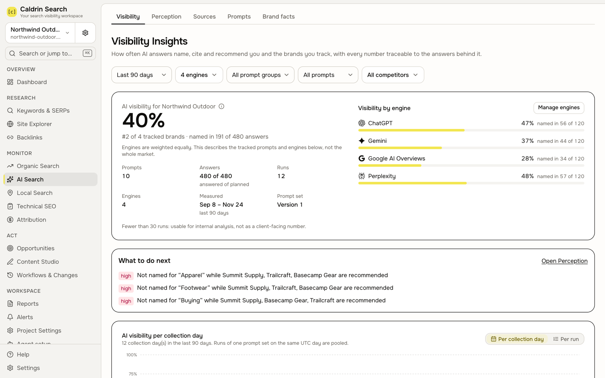
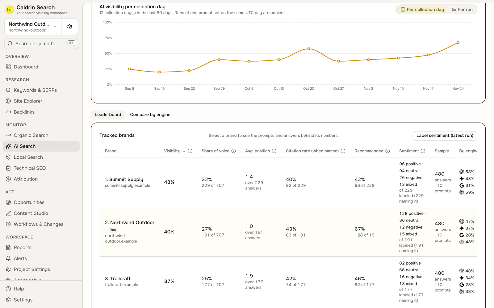
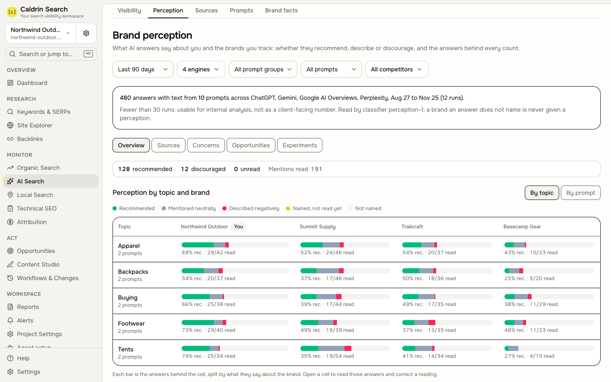
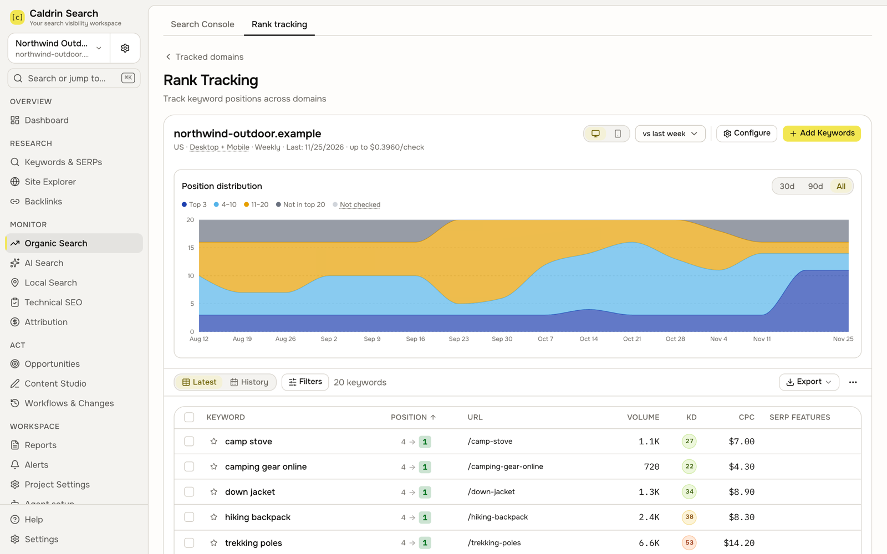
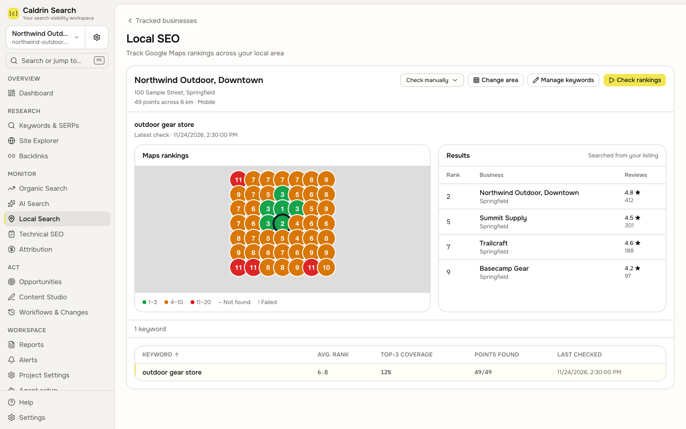
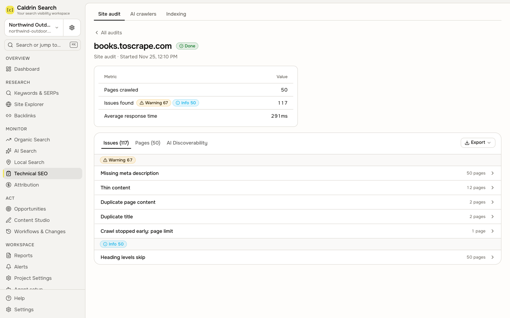

<div align="center">

# Caldrin Search (open edition)

**See where you rank in Google, and what AI answers say about you. On your own Cloudflare account, with your own keys.**

[](LICENSE)
[](https://github.com/ankurmans/caldrin-search-oss/releases)
[](https://github.com/ankurmans/caldrin-search-oss/stargazers)


[Quick start](#quick-start-local) · [Screenshots](#screenshots) · [Self-hosting](docs/SELF_HOSTING.md) · [Hosted version](https://search.caldrin.co)



</div>

A hosted version runs at [search.caldrin.co](https://search.caldrin.co). Built by [@ankurmans](https://github.com/ankurmans).

A self-hosted SEO and AI-visibility workspace for one project on your own Cloudflare account (Workers, D1, KV, R2). You bring your own provider keys; nothing is billed or proxied through anyone else.

Included: keyword research, rank tracking, site audits, backlinks, AI-answer monitoring with source evidence, Content Studio, Change Ledger, reports and exports, and a scoped MCP server.

Not included: hosted wallet and checkout, managed client logins, white-label branding and cross-client agency automation.

## Screenshots

Screenshots use made-up sample data, except the site audit, which is a crawl of the public test site books.toscrape.com. Your numbers come from your own provider keys.

| AI visibility over time and against competitors | What AI answers say about each brand |
| --- | --- |
|  |  |
| **Rank tracking** | **Local rank grid** (the map background needs a Google Maps key) |
|  |  |
| **Site audit** | |
|  | |

## Quick start (local)

```sh
pnpm install --frozen-lockfile
printf 'AUTH_MODE=password\nBETTER_AUTH_URL=http://127.0.0.1:4334\nBETTER_AUTH_SECRET=%s\n' "$(openssl rand -hex 32)" > .env.local
pnpm db:migrate:local
pnpm build && pnpm preview
```

The settings must be in `.env.local`: variables set on the command line do not reach the app. Without the file it runs with no login at all, for use on your own machine only.

Open http://127.0.0.1:4334. The first visitor creates the administrator. Add your provider keys under Settings. See `docs/SELF_HOSTING.md` to run it on your own Cloudflare account.

## Known limitations

- Spend limits stop scheduled checks, drafting and gap research. They do not yet count keyword, domain, backlink, rank or AI-visibility lookups that you or an agent start.
- The built-in chat agent can change data without asking first, including after reading text on a web page. Give chat access only to people you trust with those changes.
- Live provider integrations are covered by tests with stand-ins; check them with your own keys.

## Security

See `SECURITY.md`.

## Licence

AGPL-3.0 (`LICENSE`). The Caldrin name and logo are not covered by it; see `NOTICE.md`. Third-party notices are in `NOTICE.md` and `THIRD_PARTY_NOTICES.md`.
